# SOC Home Lab: Wazuh SIEM Detection and Attack Simulation

I built a small enterprise-style network inside VMware, deployed the Wazuh SIEM on it, enrolled Windows endpoints, and then attacked my own machines from Kali Linux to see what the defender's tools actually record. This write-up walks through the lab, the telemetry I collected, and what each piece of evidence taught me about detection.

> Everything here ran on virtual machines I own, on an isolated virtual network. Do not point these tools at systems you do not have permission to test.

## Objectives

- Build a realistic, segmented lab network with a firewall in front of it
- Stand up a SIEM and confirm logs flow from endpoints into it
- Read raw endpoint events and understand what they reveal
- Emulate attacker techniques and map them to MITRE ATT&CK
- Practise attacker reconnaissance and interpret what it shows from the defender's side

## Lab architecture

The lab has five virtual machines on one Windows laptop:

- **OPNsense firewall** (10.0.0.1): gateway for the lab LAN and manager of its IP addressing
- **Wazuh server** (`wazuh-server-siem`, 10.0.0.17): Ubuntu Server running the Wazuh manager, indexer and dashboard
- **Windows 11 endpoint 1** (`Windows1111`, 10.0.0.50): monitored by a Wazuh agent, registered as `win11.1`
- **Windows 11 endpoint 2** (`Windows2222`, 10.0.0.33): monitored by a Wazuh agent, registered as `win11.2`
- **Kali Linux attacker** (10.0.0.97): used for reconnaissance and attack simulation

OPNsense has two adapters: one on a NAT network for internet access (WAN) and one on a custom virtual network, VMnet2, for the lab LAN. Every other VM has a single adapter on VMnet2, so all lab traffic passes through the firewall's network.

### The virtual network

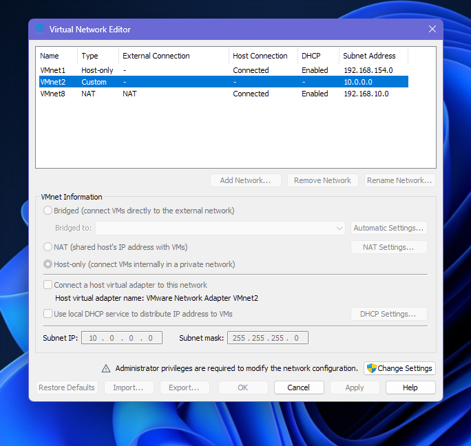

**What this shows:** VMware's Virtual Network Editor. VMnet2 is a *custom* network on `10.0.0.0/24` with VMware's DHCP service switched off and no host adapter connected. That makes it an isolated segment where OPNsense is the only device handing out addresses. The two other networks in the list (VMnet1 host-only and VMnet8 NAT) belong to VMware's defaults and are not used by the lab.

### The machines

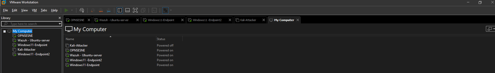

**What this shows:** The VMware library listing all five machines: OPNSENSE, Wazuh - Ubuntu-server, Windows11-Endpoint, Windows11-Endpoint2 and Kali-Attacker. The status column shows the firewall, SIEM and both Windows endpoints powered on. The attacker VM was off at the time of this capture and was started when needed.

### Validating the network

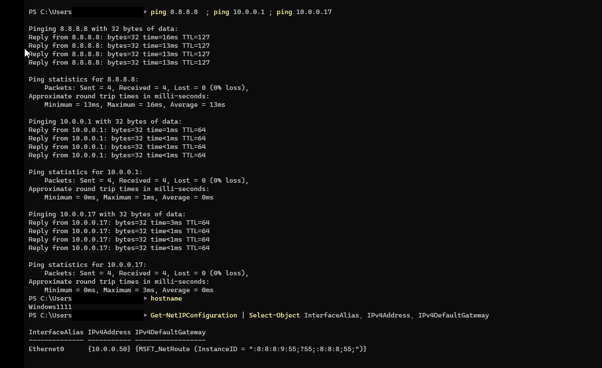

**What this shows:** PowerShell on Windows1111 pinging the internet (8.8.8.8), the OPNsense gateway (10.0.0.1) and the Wazuh server (10.0.0.17), all with 0% packet loss, followed by the adapter configuration confirming the machine holds 10.0.0.50. The Windows username in the prompt is blacked out.

The TTL values confirm the routing design. Replies from 10.0.0.1 and 10.0.0.17 return with TTL 64 (directly reachable), while 8.8.8.8 returns TTL 127, one hop lower than Windows' default of 128. That single missing hop is the OPNsense firewall forwarding the traffic out to the internet.

## Deploying the SIEM

I used Wazuh's all-in-one installer (version 4.14.9) so that the indexer, manager, Filebeat and dashboard all live on one Ubuntu server.

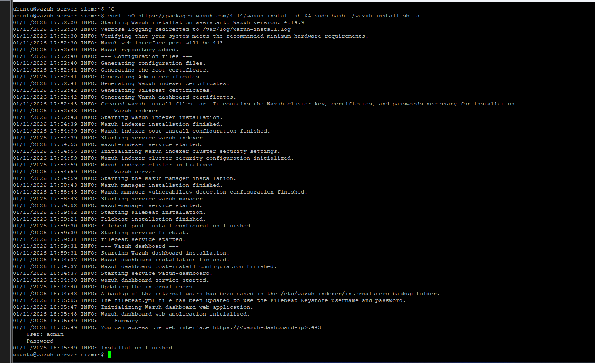

**What this shows:** The installer's log from start to finish. It generates the root, admin, indexer, Filebeat and dashboard certificates, then installs and starts each component in order: Wazuh indexer, Wazuh manager, Filebeat and the dashboard. The summary at the bottom reports the web interface on port 443 and prints the generated admin credentials; the password is redacted.

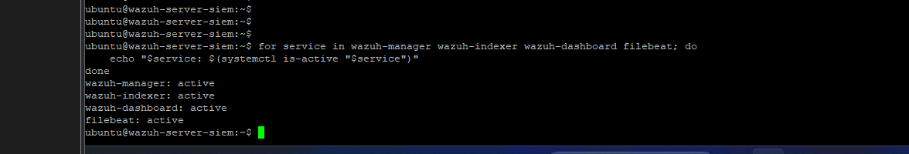

**What this shows:** A loop that queries `systemctl is-active` for the four components. `wazuh-manager`, `wazuh-indexer`, `wazuh-dashboard` and `filebeat` all report `active`. These four form the pipeline: the manager analyses events, Filebeat ships alerts to the indexer, the indexer stores them, and the dashboard presents them.

## Enrolling the endpoints

I installed the Wazuh agent on both Windows machines using the dashboard's agent deployment wizard.

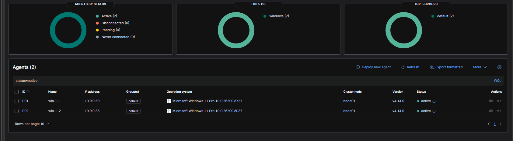

**What this shows:** The Endpoints summary page with two agents, both **active**, none disconnected, pending or never connected. The charts break the fleet down by status, operating system (both Windows) and group (both in `default`). The agent list gives each machine's identity: agent `001` is `win11.1` at 10.0.0.50 and agent `002` is `win11.2` at 10.0.0.33, both Windows 11 Pro running agent v4.14.9 and reporting to `node01`.

## Reading endpoint telemetry

With agents reporting, I used the Discover view to look at raw events from `win11.1`, filtering on Windows Event ID 4104 (PowerShell script block logging):

```
agent.name: "win11.1" and data.win.system.eventID: 4104
```

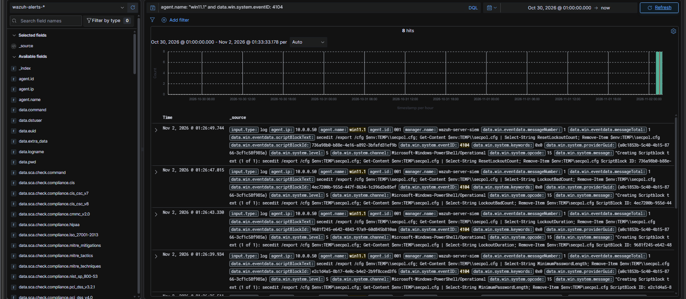

**What this shows:** Eight matching events in the `wazuh-alerts-*` index. The histogram on top shows them arriving in a tight burst at the end of the selected time range. Each row is expandable and lists the decoded fields: the agent name and IP (`win11.1`, 10.0.0.50), the manager that processed it (`wazuh-server-siem`), the channel (`Microsoft-Windows-PowerShell/Operational`), and the event ID 4104. The most useful field is the script block text itself. Here it shows a PowerShell one-liner that runs `secedit /export` to dump the local security policy to a temp file and then pulls out values such as `ResetLockoutCount`, `LockoutBadCount`, `LockoutDuration` and `MinimumPasswordLength` before deleting the file. The field list on the left also shows the SCA (security configuration assessment) compliance fields Wazuh attaches, such as CIS and MITRE mappings.

This was the clearest example of why script block logging matters to a defender: Wazuh does not just record that PowerShell ran, it records exactly what it ran, including the clean-up step.

## Adversary emulation with Atomic Red Team

To generate attacker behaviour in a controlled way, I installed Atomic Red Team on a Windows endpoint and ran its tests for MITRE ATT&CK technique **T1136.001 (Create Account: Local Account)**.

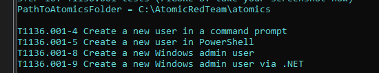

**What this shows:** The list of tests for T1136.001 as reported by Atomic Red Team, with the atomics folder at `C:\AtomicRedTeam\atomics`. The tests cover four ways an attacker creates a persistence account: from a command prompt (test 4), from PowerShell (test 5), as a new Windows admin user (test 8), and as a new admin user through .NET (test 9).

Microsoft Defender reacted as the Atomic Red Team files landed on disk.

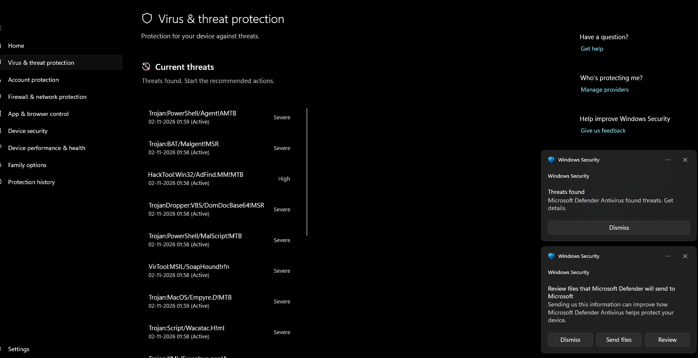

**What this shows:** Windows Security's *Virus & threat protection* page with a list of active threats, all stamped within a minute of each other. The names show how Defender classifies the content: PowerShell trojans (`Trojan:PowerShell/Agent!AMTB`, `Trojan:PowerShell/MalScript!MTB`), a batch-script trojan, a VBS dropper (`TrojanDropper:VBS/DomDocBase64!MSR`), a hacking tool (`HackTool:Win32/AdFind.MM!MTB`, an Active Directory enumeration utility) and a .NET tooling detection (`VirTool:MSIL/SoapHound!rfn`). Severities are Severe or High. The pop-up notifications on the right are Defender announcing the threats and offering to send samples to Microsoft.

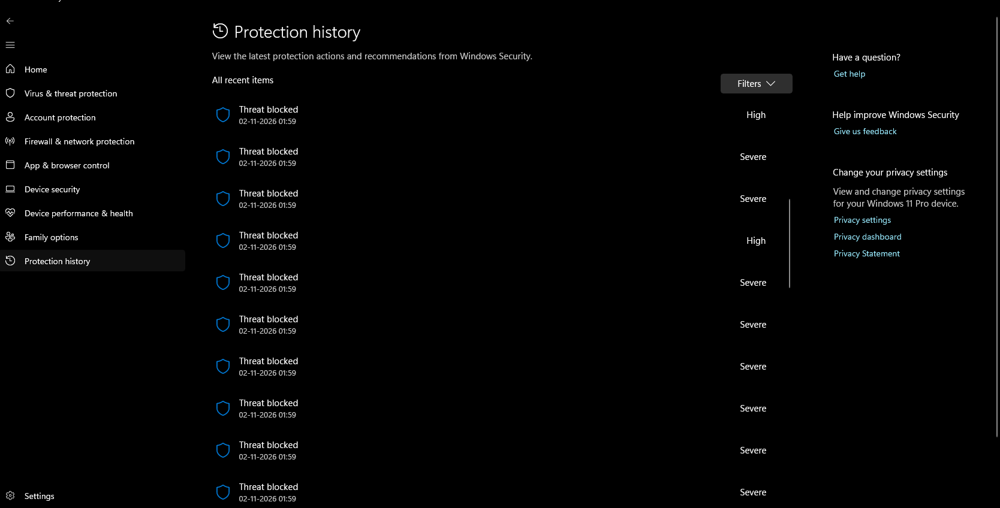

**What this shows:** The *Protection history* page, where each of those detections appears as **Threat blocked** with a Severe or High rating. This confirms Defender not only flagged the files but stopped them.

This is expected behaviour, since Atomic Red Team deliberately packages the kind of tooling attackers use. It also illustrates defence in depth: the endpoint antivirus acts first and locally, while the SIEM is where events from many machines are collected, correlated and investigated.

## Reconnaissance from Kali

From the Kali attacker I started the way a real intruder would: work out what is on the network and which services are exposed.

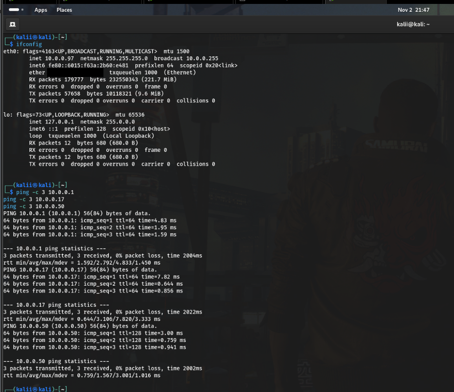

**What this shows:** The `ifconfig` output for Kali's `eth0` (10.0.0.97, netmask 255.255.255.0, broadcast 10.0.0.255; the MAC address is redacted), followed by pings to the OPNsense gateway, the Wazuh server and Windows1111, all with 0% packet loss. The TTL values give away the operating systems without any scanning: 64 for the gateway and the Ubuntu server (Linux/BSD-style) and 128 for the Windows endpoint.

I then scanned the file-sharing and remote-desktop ports on two targets, skipping host discovery because Windows may ignore ping:

```bash
nmap -Pn -p 445,139,3389 10.0.0.50
nmap -Pn -p 445,139,3389 10.0.0.17
```

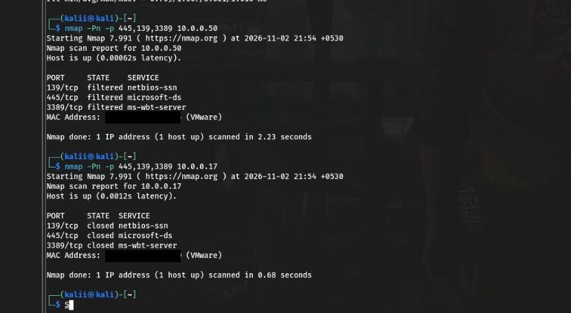

**What this shows:** Two Nmap runs side by side. Against the Windows endpoint (10.0.0.50) ports 139 (NetBIOS), 445 (SMB) and 3389 (RDP) all come back **filtered**. Against the Wazuh server (10.0.0.17) the same three ports are **closed**. MAC addresses are redacted.

The two results mean different things. *Filtered* means a firewall is silently dropping the probes (here, Windows Defender Firewall), so the attacker cannot tell whether a service is behind it. *Closed* means the host answered that nothing is listening. For a defender, a filtered result is the sign that host protection is doing its job.

## A dedicated account for credential attacks

For credential-attack testing I created a separate local account on the Windows endpoint so that failed-logon activity would never touch a real user.

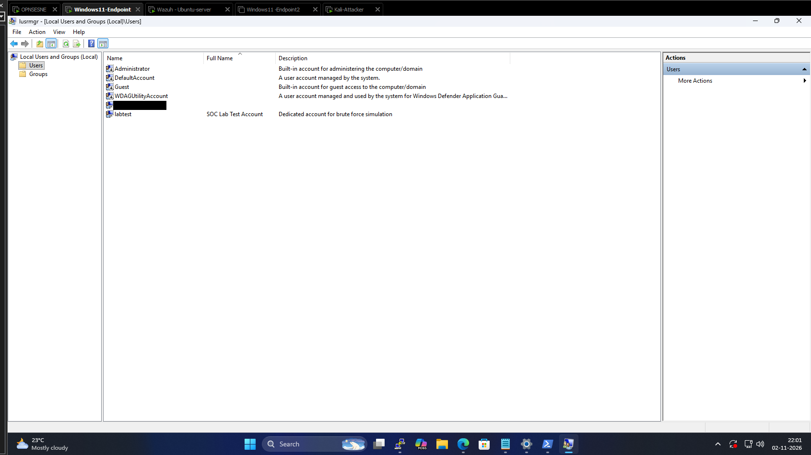

**What this shows:** The Local Users and Groups console listing the built-in accounts (Administrator, DefaultAccount, Guest, WDAGUtilityAccount), the machine's main account (name redacted) and the new account `labtest`, full name "SOC Lab Test Account", described as the dedicated account for brute-force simulation. Failed logons against it generate Windows Event ID 4625, which is the event a SIEM rule for brute force would key on.

## Detection rule: SSH brute force

Wazuh's built-in rule 5760 ("sshd: authentication failed") fires on every single failed SSH login, which is noisy because one mistyped password is normal. I wrote a custom rule that fires only when rule 5760 triggers five times within 120 seconds, and tags the alert with MITRE technique **T1110 (Brute Force)**:

```xml
<group name="local,syslog,sshd,">
  <rule id="100002" level="10" frequency="5" timeframe="120">
    <if_matched_sid>5760</if_matched_sid>
    <description>SSH brute-force attack detected</description>
    <mitre>
      <id>T1110</id>
    </mitre>
    <group>authentication_failures,pci_dss_11.4,mitre,</group>
  </rule>
</group>
```

The file is in [`rules/ssh_bruteforce_rule.xml`](rules/ssh_bruteforce_rule.xml). It belongs in `/var/ossec/etc/rules/local_rules.xml` on the manager. The design idea is threshold-based detection: individual failures are weak signals, but a burst from the same activity is a pattern worth an analyst's time. Adding `<same_source_ip />` would tighten the rule so that it counts failures from one address only.

## Key takeaways

- A SIEM is only as useful as its log sources: script block logging turned a routine PowerShell event into a full record of what the command did.
- TTL values and filtered-versus-closed ports let an attacker (and a defender reading the same data) learn a lot before any exploit is sent.
- Endpoint protection and a SIEM complement each other: Defender blocked the Atomic Red Team payloads on the host, while Wazuh gives the central, searchable record.
- Detection rules should describe patterns rather than single events, which is why the brute-force rule uses a count and a time window.
- Mapping activity to MITRE ATT&CK (T1136.001, T1110) gives alerts a common language that analysts and reports share.

## Tools

VMware Workstation, OPNsense, Wazuh 4.14.9, Ubuntu Server, Windows 11 Pro, Kali Linux, Nmap, Atomic Red Team, Microsoft Defender.

## Repository layout

```
.
├── README.md
├── images/                       # redacted screenshots used above
└── rules/
    └── ssh_bruteforce_rule.xml   # custom Wazuh rule 100002
```

## Privacy note

Screenshots were redacted before publishing: the generated Wazuh admin password, the Windows account name, network adapter (MAC) addresses, and browser tabs and taskbar items unrelated to the lab. The IP addresses shown are private RFC 1918 addresses on an isolated virtual network.
